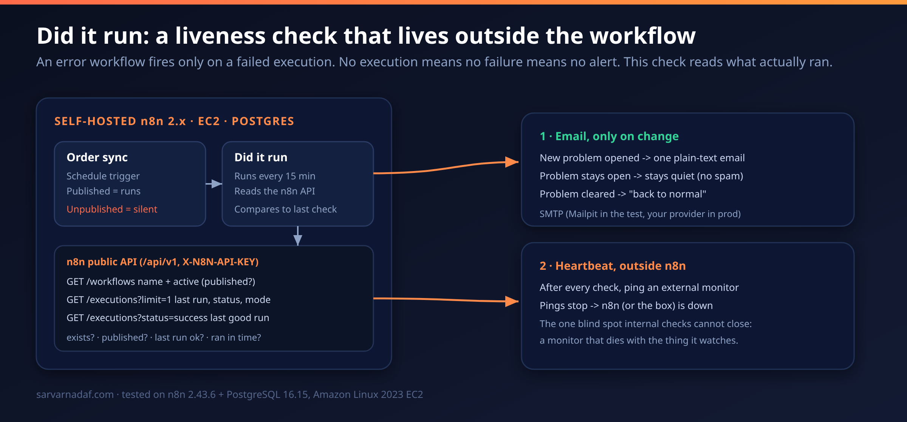
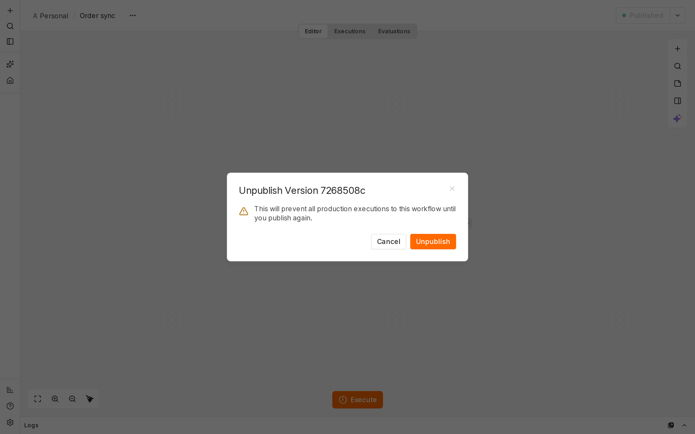
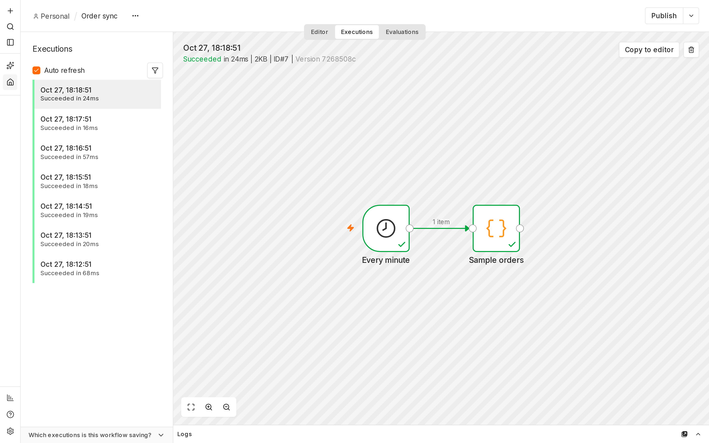
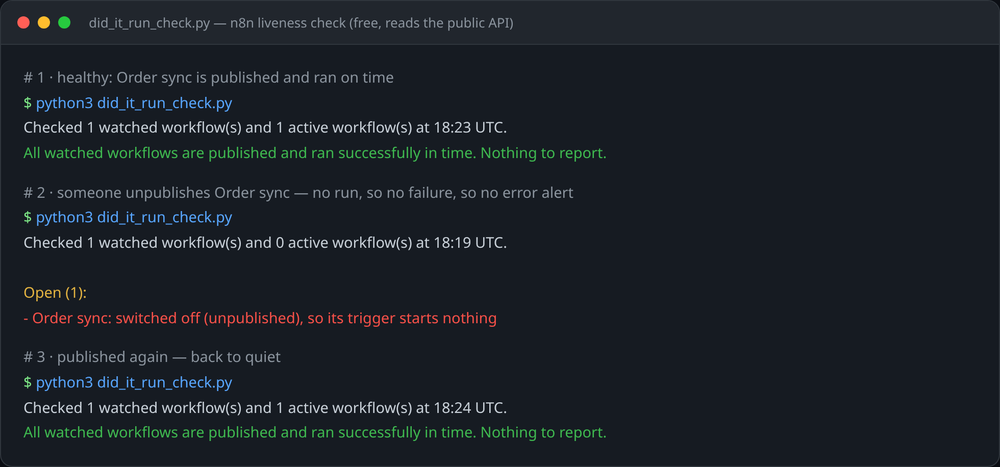
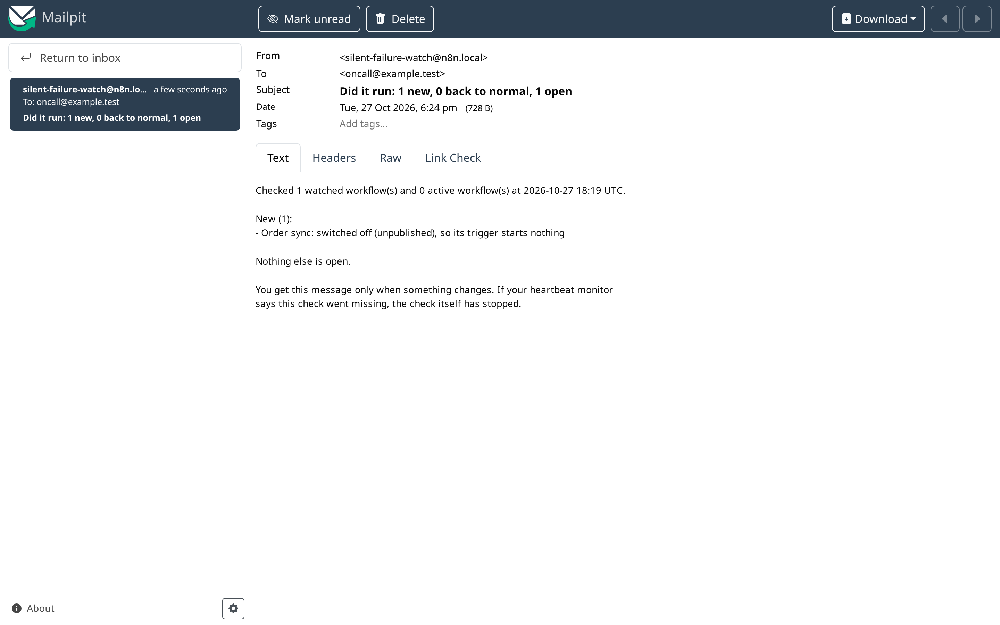

# 🛰️ Silent Failure Watch finds the n8n workflow that stopped running

### Your n8n error workflow fires only when an execution **fails**. Unpublish a workflow and nothing runs. Nothing runs, so nothing fails. So no alert ever fires, and the automation is dead while the dashboard looks calm. This is a liveness check that reads what **actually ran**, catches the workflow that went quiet, and emails you once when it does. It runs on the free n8n API, on your own server.

[](https://n8n.io)
[](https://www.postgresql.org)
[](https://aws.amazon.com/ec2/)
[](https://docs.docker.com/compose/)
[](#-getting-started)
[](LICENSE)

**🛰️ A follow-up to [getting self-hosted n8n running on AWS](https://dev.to/sarvar_04): this plugs the monitoring hole that setup leaves open.**

> ### Every n8n monitoring guide starts with an error workflow. An error workflow is structurally blind to the most common way a cron job dies: it never starts. This check asks the other question, "did it run?", and alerts when the answer changes.

[The Problem](#-the-problem) · [Why Error Workflows Are Blind](#-why-error-workflows-are-blind) · [How It Works](#-how-it-works) · [The Blind Spot](#-the-one-blind-spot) · [Getting Started](#-getting-started)

---

### The check, across three states

*A separate workflow reads the n8n API every 15 minutes and asks four questions per watched workflow (the decision). When the answer changes, one plain-text email goes out and a heartbeat pings an outside monitor (the signal).*



---

## 📸 Screenshots

*Captured on the live stack in this repo (n8n 2.43.6 + Postgres 16 + Mailpit).*

**1. n8n's own unpublish confirmation, the root cause in its own words: "This will prevent all production executions to this workflow until you publish again."**



**2. The silent failure, made visible. `Order sync` ran every minute (18:12 → 18:18), then went quiet the moment it was unpublished. Every run "Succeeded", there is no failed run for an error workflow to catch, just an absence.**



**3. The standalone check reads what actually ran and catches it across three states (healthy, the unpublished ghost, and back to normal) straight from `did_it_run_check.py` against the live API.**



**4. The alert email that goes out when the answer changes (delivered over SMTP to Mailpit in the test): "Order sync: switched off (unpublished), so its trigger starts nothing."**



---

**📖 Table of Contents**

- [Screenshots](#-screenshots)
- [The Problem](#-the-problem)
- [Why Error Workflows Are Blind](#-why-error-workflows-are-blind)
- [How It Works](#-how-it-works)
- [The One Blind Spot](#-the-one-blind-spot)
- [Tech Stack](#️-tech-stack)
- [Getting Started](#-getting-started)
- [Proof It Works](#-proof-it-works)
- [Tuning (Day 2)](#-tuning-day-2)
- [Project Structure](#-project-structure)
- [What Was Tested](#-what-was-tested)
- [FAQ](#-faq)
- [License](#-license)

---

## 🤔 The Problem

Scheduled workflows rarely die by throwing an error. They go quiet. Someone unpublishes one during an edit and forgets to publish again. A schedule trigger gets changed and never fires. A restored backup comes back inactive. A deploy script re-imports a workflow and leaves it off.

In every one of those, the trigger never fires, so **no execution record is created**. There is no failed run to catch, because there is no run at all.

The alerting you trust most, the error workflow, needs an execution to exist before it can judge it failed. So it is structurally incapable of seeing the most common way a cron job dies.

> So Silent Failure Watch does the part the error workflow skips: it reads what **actually ran**
> through the n8n API, notices when a watched workflow is off or overdue, and emails you once,
> only when something changes.

---

## 🙈 Why Error Workflows Are Blind

An error workflow does one job well, and only that job: it fires when an execution fails.

| How a workflow dies | Does an execution happen? | Does the error workflow fire? |
|---|---|---|
| A node throws mid-run | Yes (`status=error`) | ✅ Yes |
| **Unpublished during an edit** | **No** | ❌ **Never** |
| **Schedule trigger changed, stops firing** | **No** | ❌ **Never** |
| **Restored a backup, came back inactive** | **No** | ❌ **Never** |
| **Deploy re-imported it and left it off** | **No** | ❌ **Never** |

Four of the five most common failures produce **no execution at all**. The alert you rely on cannot see any of them. It is not misconfigured. It is pointed at the wrong thing.

---

## 🧠 How It Works

A separate scheduled check, every 15 minutes, reads the n8n public API and answers four questions per watched workflow:

```
         watched workflow (Order sync, schedule trigger)
                         │  published = runs   ·   unpublished = silent
                         ▼
   ┌──────────────────────────────────────────────────────┐
   │  Did it run?  (runs every 15 min, reads the n8n API)   │
   │                                                        │
   │  GET /workflows                 exists? · published?   │
   │  GET /executions?limit=1        last run failed?       │
   │  GET /executions?status=success ran within the limit?  │
   └──────────────────────────────────────────────────────┘
                 │                               │
     1 · email only on change         2 · heartbeat to an
     (open / back to normal,          external monitor; if the
      quiet in between)               pings stop, n8n is down
```

The `active` field from `GET /workflows` is the published flag. When a workflow is unpublished, `active` is `false`, and that single boolean is the entire detection. **No execution is required**, which is exactly why it catches what an error workflow cannot.

- **`did_it_run_check.py`** is the heart: it reads the watch list, calls the three API endpoints above, and prints one plain-text report. Scoped to read-only, so the key cannot change anything if it leaks.
- **`order-sync.json`** is a sample scheduled workflow, safe to publish and break, so you can prove the behaviour before pointing the check at real work.
- **`docker-compose.yml`** stands up the production-shaped stack: n8n 2.43.6 on Postgres 16, plus Mailpit so you can see the alert without a real mailbox.

Two design rules make it usable instead of annoying: it **emails only on change** (open once, clear once, quiet in between), and it keeps **one check outside n8n** (the heartbeat below).

---

## 🛰️ The One Blind Spot

The check runs inside n8n. If n8n is down, out of memory, mid-restart, or the EC2 instance is stopped, the check does not run either. **A monitor that lives inside the thing it watches dies with it**, and the dashboard stays calm because there is no dashboard.

Close it with a heartbeat: after every check, ping an external uptime or cron monitor (free tier is plenty). Tell it to expect a ping every 15 minutes. When the pings stop, the outside service alerts you, because the absence of a ping is the signal.

> This is the only gap internal instrumentation cannot close. Treat the in-n8n check and the
> external heartbeat as one system, not two options. Do not ship without the outside layer.

---

## 🛠️ Tech Stack

| Component | Technology |
|---|---|
| 🛰️ The check | A scheduled read of the **n8n public API** (`/api/v1`, read-only key) |
| 📬 The alert | Plain-text email over SMTP (**Mailpit** in the test, your provider in prod) |
| 💓 The outside layer | A **heartbeat** to any external uptime/cron monitor |
| 🧱 Stack | **n8n 2.43.6** on **PostgreSQL 16**, Docker Compose v2 |
| ☁️ Tested on | **Amazon Linux 2023 EC2** (amd64) |
| 🧪 Reproducible | `did_it_run_check.py` runs on the free API, no paid file needed |

---

## 🚀 Getting Started

**Prerequisites:** Docker + Compose v2, `openssl`, Python 3. An EC2 box or any Linux host.

```bash
# 1. clone
git clone https://github.com/simplynadaf/n8n-silent-failure-watch
cd n8n-silent-failure-watch

# 2. start the stack (n8n 2.43.6 + Postgres 16 + Mailpit, all on 127.0.0.1)
printf "N8N_ENCRYPTION_KEY=%s\nPOSTGRES_PASSWORD=%s\nGENERIC_TIMEZONE=UTC\n" \
  "$(openssl rand -hex 24)" "$(openssl rand -hex 16)" > .env
docker compose up -d
curl -s http://localhost:5678/healthz      # wait for {"status":"ok"}
```

On EC2, keep the ports on localhost and tunnel in; do not open them in the security group:

```bash
ssh -L 5678:localhost:5678 -L 8025:localhost:8025 ec2-user@<PUBLIC_IP>
```

Then:

1. Open `http://localhost:5678`, create the owner account.
2. **Settings -> n8n API -> Create API key.** Scope it **read-only** (`workflow:read`, `workflow:list`, `execution:read`, `execution:list`). A read-only key cannot change anything if it leaks.
3. Import `order-sync.json`, publish it.
4. Run the check against it:

```bash
export N8N_API_URL="http://localhost:5678/api/v1"
export N8N_API_KEY="<your read-only key>"
python3 did_it_run_check.py
```

5. Unpublish `Order sync` in the UI, run the check again, and watch it report the silent failure. Publish it again to see it clear.

How a real EC2 + Postgres box differs: [`docs/ec2-notes.md`](docs/ec2-notes.md). The traceable numbers behind the proof: [`docs/test-evidence.md`](docs/test-evidence.md).

---

## ✅ Proof It Works

Measured on **n8n 2.43.6 + PostgreSQL 16.15** on an **Amazon Linux 2023 EC2** box, 2026-10-27 UTC. `Order sync` runs every minute.

```text
executions BEFORE unpublish: 2
Order sync active after unpublish: False   (unpublished at 11:01:22 UTC)
executions AFTER 150s unpublished: 2
=> new executions while unpublished: 0
```

Zero new executions across at least two missed scheduled runs. Republished, and a new run appeared within 70 seconds (count 2 -> 3). The standalone check, run against the same stack:

```text
# healthy (Order sync published)
All watched workflows are published and ran successfully in time. Nothing to report.

# after I unpublish Order sync
Open (1):
- Order sync: switched off (unpublished), so its trigger starts nothing

# after I publish it again
All watched workflows are published and ran successfully in time. Nothing to report.
```

That middle state is the one your error workflow never prints. Full traceable log: [`docs/test-evidence.md`](docs/test-evidence.md).

---

## 🎛️ Tuning (Day 2)

| Workflow rhythm | `max_quiet_minutes` |
|---|---|
| Every 15 min | 45 |
| Hourly | 130 |
| Daily | 1500 |
| Weekly | 10140 |
| Event-driven (webhook, no schedule) | 0 (exists + published only) |

Rule of thumb: about 3x the schedule interval. And keep successful executions in the list longer than your largest quiet window (`EXECUTIONS_DATA_SAVE_ON_SUCCESS: all`, and mind `EXECUTIONS_DATA_MAX_AGE` / `EXECUTIONS_DATA_PRUNE_MAX_COUNT`), or the freshness check goes blind.

---

## 📁 Project Structure

```
n8n-silent-failure-watch/
├── README.md
├── LICENSE                     # MIT
├── docker-compose.yml          # n8n 2.43.6 + Postgres 16 + Mailpit (production-shaped)
├── order-sync.json             # sample scheduled workflow to watch and break
├── did_it_run_check.py         # ★ standalone liveness check, free, no paid file
├── assets/
│   ├── architecture.png / .svg # the diagram above
│   ├── cover-devto.png         # 1000x420 article cover
│   └── cover-wide.png          # 1200x675 wide cover
└── docs/
    ├── ec2-notes.md            # how a real EC2 + Postgres box differs
    ├── test-evidence.md        # the traceable numbers behind "Proof It Works"
    └── youtube-metadata.md     # title, description, timestamps, tags
```

---

## 🧪 What Was Tested

**Verified (2026-10-27 UTC):** n8n 2.43.6 on PostgreSQL 16.15, amd64, Amazon Linux 2023 EC2, Docker 25.0.14, Compose v2.39.1. Zero executions while unpublished (150s). The three API response shapes. The three-state check output. An alert delivered via SMTP to Mailpit. A read-only scoped key working; a write attempt returning `{"message":"Forbidden"}`.

**Not tested, so not claimed:** the external heartbeat end to end, a real SMTP provider, the n8n 1.x -> 2.x upgrade on Postgres, queue mode, n8n Cloud. If you run any of those, treat the relevant step as "should work, verify on your side."

---

## ❓ FAQ

**Does this replace my error workflow?**
No. They are complementary. The error workflow catches failed runs. This catches the runs that never happen. Run both.

**Do I need a paid tool?**
No. This repo runs entirely on the free n8n public API, the check is here and costs nothing. That said, I first came across this "did it run?" approach through **Ahmet at Krafera**, who built a packaged set of importable n8n monitoring workflows and shared it with me. It is what put me onto the blind spot in the first place. The entry tier is the same "did it run" check this repo builds; higher tiers add a daily order count-check, an error alert with secrets masked, and backup/retry/weekly-report workflows. If you would rather import a tested file than keep a script running, or want the pieces I did not build here, it is a genuinely easier on-ramp, especially across client instances: [Krafera Silent Failure Watch](https://krafera.gumroad.com/l/lltue). No affiliate, just honest credit to the thing that got me started.

**Will it spam me?**
No. It emails once when a problem opens, once when it clears, and stays quiet in between.

**Does it work on SQLite / n8n Cloud / queue mode?**
Tested on self-hosted Postgres. The logic only uses the public API and should port, but those are not verified here.

**Why read-only API key?**
The check never writes. A read-only key cannot change or delete anything if it ever leaks. A write attempt from a read-only key returns `{"message":"Forbidden"}`, confirmed in the test.

---

## 🔗 Links

- ✍️ Full write-up: https://dev.to/sarvar_04
- ▶️ 3-minute walkthrough: https://www.youtube.com/@sarvar-nadaf
- 🌐 Part 1 (n8n on AWS): https://sarvarnadaf.com

---

## 📝 License

MIT. See [LICENSE](LICENSE).

---

## 👨‍💻 Author

**Sarvar Nadaf** · Cloud Architect · AI Infrastructure & DevOps

[Portfolio](https://sarvarnadaf.com) · [LinkedIn](https://www.linkedin.com/in/sarvar04/) · [GitHub](https://github.com/simplynadaf) · [Dev.to](https://dev.to/sarvar_04) · [YouTube](https://www.youtube.com/@sarvar-nadaf) · [AWS Builder Center](https://builder.aws.com/community/@sarvar)

*The error workflow catches the runs that fail. This catches the runs that never happen. Run both.*

**If this caught a silent failure in your own n8n, consider a ⭐**
